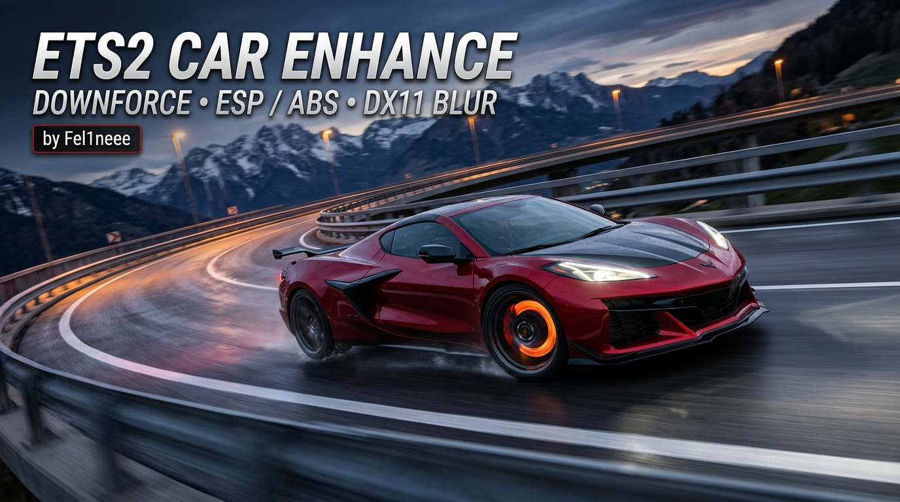

# ETS2 Car Enhance v2.1.2 (by Fel1neee)



Native C++ / DX11 plugin for **Euro Truck Simulator 2** that transforms passenger car and supercar driving physics, adds real-time thermal simulation for tires and brakes, high-speed radial motion blur, and an interactive in-game telemetry HUD & overlay menu.

> **Note:** Automatically disables physics assists on trucks/trailers (`CarClass::Truck`) so vanilla trucking physics stay untouched.

---

## Key Features

### 1. Physics & Handling
- **Speed-Dependent Aero Downforce:** Quadratic downforce curve with front/rear axle balance (`aero_front_pct`) and vertical anti-bounce damping.
- **Dual-Loop ESP / TC / ABS (`OFF` & `L1–L5`):**
  - Yaw-rate + slip-angle stabilization with speed-sensitive steering damping and speed scrub (`esp_brake_drag`).
  - High-speed ABS longitudinal brake assist with clamped nose-down **Brake Dive**.
- **Pacejka-Lite Tire Model & Kamm Circle:**
  - Progressive grip curve (`0–3.5°` peak, `3.5–11.5°` controllable edge, `11.5°+` breakaway).
  - Pedal weight transfer: **Trail Braking** turn-in bite, smooth front grip fade on excessive corner braking, and controllable power oversteer.
  - 4 tire compounds: **Slick**, **Semi-Slick**, **Street**, **Narrow Street**.

### 2. Thermal Simulation (`dt` via `QueryPerformanceCounter`)
- **4-Wheel Tire Temps (`FL / FR / RL / RR`):** Cold start synced to in-game time of day (`~16–27°C`), automatic reset on vehicle change, cornering load heating, highway cooling, and cold/overheat grip loss.
- **3 Brake Disc Types & Real Brake Fade:**
  - **Standard:** instant cold bite, fades above `430°C`.
  - **Sport:** stronger airflow cooling, fades above `560°C`.
  - **Carbon-Ceramic:** ~`86%` cold bite below `150°C`, holds up to `780°C`.
  - Overheated brakes counteract native ETS2 braking force ("soft pedal" lengthening stopping distance).

### 3. DX11 Radial Speed Blur & In-Game Overlay
- **DX11 Post-Process Motion Blur:** Starts smoothly around `85 km/h` and scales up to `290+ km/h` while keeping the center, mirrors, and HUD sharp.
- **Two UI Modes (`Insert` / `F6` / configurable wheel button):**
  - **Basic Mode:** Quick pre-drive setup (`ABS OFF/1–5`, `TC/ESP OFF/1–5`, 4 tire types, 3 brake types, 3 body class cards with vector silhouettes).
  - **Advanced Mode:** Full fine-tuning sliders for blur, downforce, ESP/ABS/TC, and tire/Kamm parameters.
- **Draggable Mini Telemetry HUD:**
  - Top steering angle strip with glowing dot.
  - Live `ABS` / `TC` indicators and tire/brake temperatures (°C).
  - Top-down chassis view with temperature-colored treaded tires, glowing brake discs, turning front wheels, and center **G-Force meter**.
  - Live HUD scaling (`0.70x – 1.80x`) saved to `.ini`.

---

## Installation (Players)
1. Download `ets2_car_enhance.dll` (from Releases or `build/`).
2. Copy `ets2_car_enhance.dll` into:
   `<ETS2_DIR>\bin\win_x64\plugins\`
3. Launch ETS2 (64-bit, DirectX 11).
4. Press **`Insert`** or **`F6`** (or bind any steering wheel button in the menu) to open the overlay.

---

## Building from Source
Requires **llvm-mingw** (`g++` / `clang++` with C++17 & Windows SDK headers):
```powershell
.\build.ps1
```
